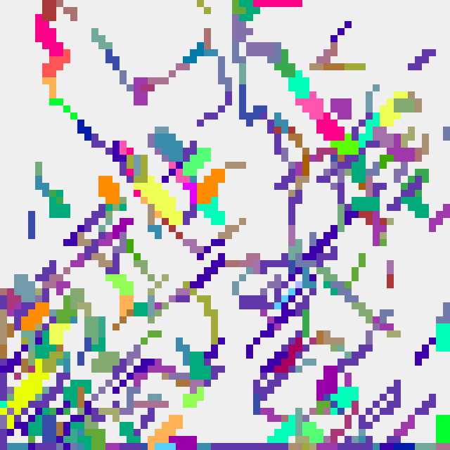
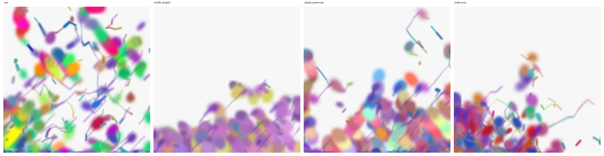
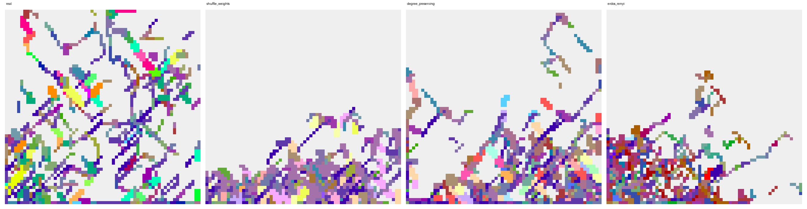
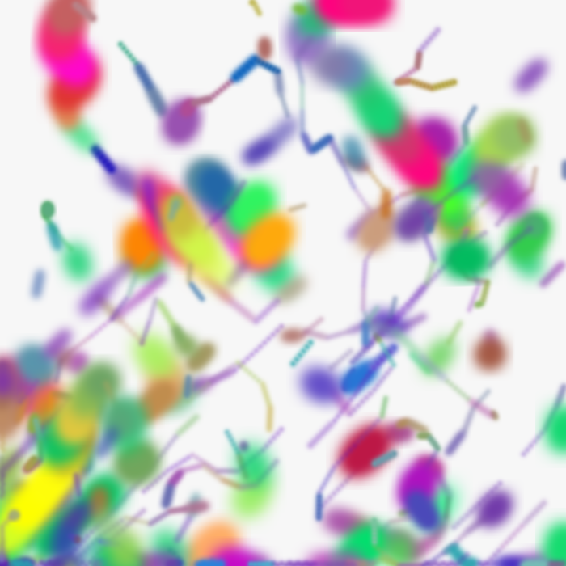
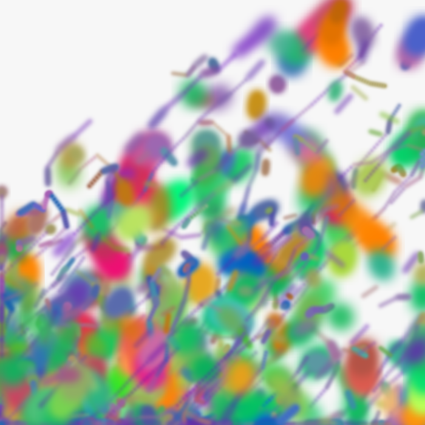
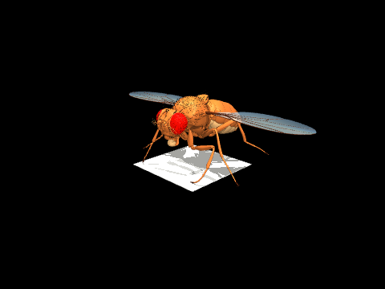
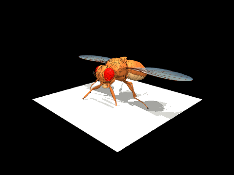
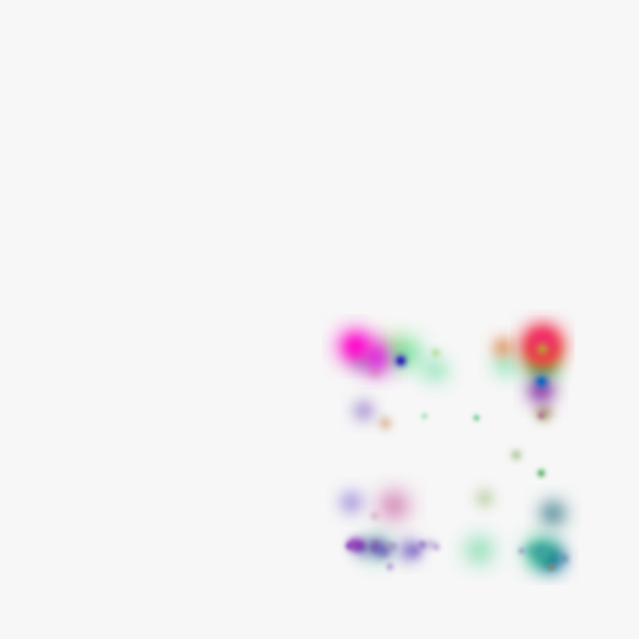
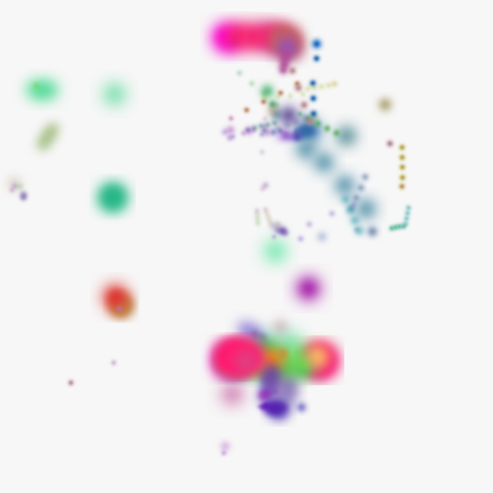

# fruit-fly

Simulación del cerebro completo de una mosca de la fruta, conectada a un cuerpo físico que pinta y a un DAW que toca música en vivo. Todo sale del conectoma real de *Drosophila melanogaster* (MaleCNS v1.0, Janelia): el cableado medido no se toca, solo se aprende a leer su actividad.

*A whole-brain spiking simulation of the fruit fly connectome (161k neurons, 14M synapses) driving a physics-based body that paints, and a live REAPER session that plays music. Validated against shuffled and random wiring controls.*



## Qué hay

| Parte | Qué hace |
|---|---|
| `packages/flybrain` | Simulador de neuronas con disparos (LIF) sobre el conectoma completo, carga de datos, calibración, poblaciones por superclase y controles de topología |
| `art-fly` | La actividad del cerebro mueve una pluma (2D) y después un cuerpo 3D de seis patas en MuJoCo que pinta un lienzo |
| `music-fly` | Un subgrafo motor del cerebro opera una sesión de REAPER en vivo por medio de un ReaScript en Lua |

## Números medidos

| Métrica | Valor |
|---|---|
| Neuronas simuladas | 161.429 |
| Conexiones con signo | 14.262.680 |
| Velocidad (CPU o Apple MPS) | 0,107× tiempo real |
| Tasa media de disparo, calibrada | 3,3 Hz |
| Contacto real de las patas al pintar | 98 % de los intentos, seis patas |
| Lazo en vivo de music-fly | 33 a 40 Hz, 4.491 neuronas, 0 pasos saltados en 15 s |

## El cableado real importa, y se mide

Cada resultado se compara contra tres controles que conservan el número de neuronas pero rompen el cableado medido:

| Control | Efecto |
|---|---|
| Pesos barajados | La actividad explota a 17 a 22 Hz: los pesos medidos sostienen el balance entre excitación e inhibición |
| Red aleatoria (Erdős–Rényi) | Todo se aplana a 3,2 Hz uniformes: la heterogeneidad viene del cableado específico |
| Grados preservados | Queda entre los dos |

En la obra también se nota: el conectoma real ocupa todo el lienzo y los controles se hunden contra el borde. El rango dinámico de los z-scores es 2,22 en el real contra 1,01 a 1,26 en los controles.



La misma comparación en la versión pixel art: el real a la izquierda, después los tres controles.



## Galería

| Obra continua (12 s de actividad) | Obra continua (40 s de actividad) |
|---|---|
|  |  |
| **Cuerpo 3D en MuJoCo** | **La mosca pintando con seis patas** |
|  |  |
| **Lienzo pintado con el cuerpo 3D** | **Lienzo pintado con seis patas** |
|  |  |

## Reglas del proyecto

- **El conectoma no se toca.** Se entrena el decodificador, nunca el grafo.
- **Nada de decodificadores discontinuos** (hashes o funciones que rompan la relación entre actividad y salida).
- **Test de cerebro congelado:** ninguna pieza entrenada se da por buena si funciona igual con el cerebro detenido.
- **Lo autoral se declara:** cada documento de arquitectura tiene una tabla de qué sale del conectoma y qué es decisión nuestra.

## Cómo correrlo

Necesita los datos de MaleCNS v1.0 en `data/` (no van en el repo por peso). Ver [art-fly/ARQUITECTURA.md](art-fly/ARQUITECTURA.md) para descargarlos.

```bash
# entorno del cerebro (Python 3.12)
python packages/flybrain/scripts/record_trace.py --seconds 12 --sample-every 10
python art-fly/scripts/paint.py --render pixel --color poblacion --cells 64
python art-fly/scripts/compare_controls.py --render pixel --reuse-traces
```

El cuerpo 3D usa un segundo entorno con Python 3.10 (MuJoCo y flybody). music-fly necesita REAPER con el script `music-fly/reaper/fly_listener.lua` cargado; la carpeta del repo se indica con la variable `FRUITFLY_ROOT` y la clave del websocket de OBS con `OBS_PASSWORD`.

## Estado

Fases F0 y F1 completas, F2 (cuerpo 3D y consola de music-fly) en curso, septiembre de 2026. Detalle en [docs/contexto/ESTADO.md](docs/contexto/ESTADO.md). Desarrollado con asistencia de IA siguiendo las reglas de [CLAUDE.md](CLAUDE.md); la idea, el diseño de los experimentos y los controles son míos.

## Datos y atribución

Los datos de MaleCNS v1.0 ([male-cns.janelia.org](https://male-cns.janelia.org/)) son de Janelia FlyEM y colaboradores, con licencia CC-BY 4.0. Cualquier uso de las obras debe citar el artículo de Cell que publica el conectoma y el preprint de Berg et al., según indica el sitio del dataset. Referencias completas en la sección 14 de [art-fly/ARQUITECTURA.md](art-fly/ARQUITECTURA.md).

Juan Francisco Domenech Rossello · [justhipo.github.io](https://justhipo.github.io)
