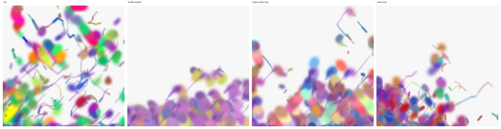
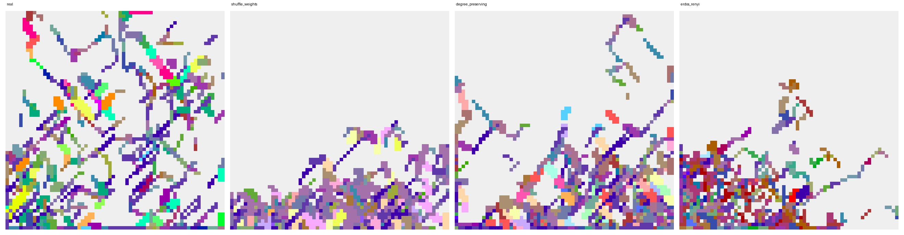
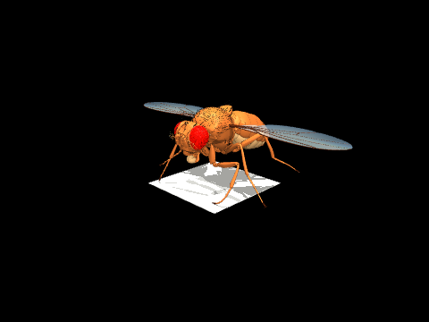
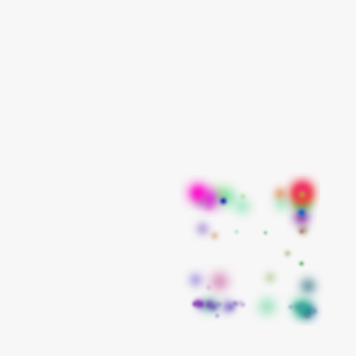

# Documentación técnica: mosca que pinta

Documento de arquitectura e implementación para la idea 3 (arte generativo) descrita en [IDEAS.md](../IDEAS.md).

La idea 4 (música) se separó a su propio proyecto y creció de alcance: ya no es sonificación MIDI sino una mosca que **opera un DAW en vivo**. Ver [music-fly/ARQUITECTURA.md](../music-fly/ARQUITECTURA.md).

Estado: **F0 y F1 completos**. Simulador del conectoma funcionando, decodificador de pluma y dos modos de render, controles de topología corridos. F2 (cuerpo 3D) sin empezar.
Fecha de investigación: 2026-09-14. Todo dato de versión o release verificado contra la fuente en esa fecha.

---

## 0. Resumen ejecutivo

Existe un ecosistema completo de proyectos de conectoma de mosca. No partimos de cero prácticamente en ninguna capa, salvo en la que nos importa (pintar).

**Lo que reutilizamos**: el dataset MaleCNS, matrices de conectividad ya preprocesadas, un cuerpo 3D de mosca anatómicamente correcto en MuJoCo con cinemática inversa incluida, y un modelo del sistema visual.

**Lo que construimos nosotros**: el canvas y la deposición de pintura, el planificador de trazos, el decodificador de actividad neuronal a parámetros visuales, y el loop de entrenamiento.

**Decisión de alcance que simplifica todo (2026-09-14)**: la mosca **no camina**. Queda fija en su sitio y solo mueve las patas. Esto no es una limitación, es la decisión de diseño más importante del proyecto y se explica en 6.4: elimina el único problema que nadie del ecosistema resolvió, y además reproduce el paradigma experimental estándar de la neurociencia de Drosophila.

**La restricción dura que define toda la arquitectura**: simular el cerebro completo (161.429 neuronas) corre a **0,107x tiempo real en este M4 Pro, medido sobre los datos reales** (sección 5.4). Es decir, unas 9 veces más lento que la realidad. No impide ver la simulación en vivo, pero sí determina a qué velocidad se ve (sección 3.3).

---

## 1. Entorno local verificado

Datos reales de la máquina donde corre esto:

| Item | Valor |
|---|---|
| Chip | **Apple M4 Pro** |
| macOS | 26.6.2 (build 25G83) |
| Arquitectura | arm64 (Apple Silicon) |
| RAM unificada | 24 GB |
| Núcleos CPU | 12 (8 performance + 4 efficiency) |
| Núcleos GPU | 16, Metal 4 |
| Python disponible | 3.10.0, **3.12.14**, 3.13.11 |
| Node | v24.4.1, npm 11.4.2 |
| Gestores | uv 0.12.6, brew 6.0.22 |
| Video | ffmpeg 8.0 |
| **Disco libre** | **15 GB de 460 GB** (tras limpiar cachés de Xcode) |

Consecuencias directas:

- **No hay CUDA.** Todo lo que dependa de NVIDIA queda descartado (FastFly, los extras `[tf]`/`[ray]` de flybody, el extra `[warp]` de flygym). Aceleración vía Metal/MPS solamente.
- **No hay EGL en macOS**, pero eso no impide ver la simulación en vivo. EGL es la ruta *headless* de servidores Linux. Acá se usa `glfw`/CGL para render offscreen, y `mjpython` para el viewer interactivo, que es una ventana real. Ver 3.3.
- **Python 3.12.14 ya instalado** vía `uv python install 3.12`, en `~/.local/bin/python3.12`. Es la versión base del entorno "brain".
- 24 GB de memoria **unificada** alcanzan cómodamente: CLIP ViT-L/14 son 1,7 GB y el grafo completo en GPU ~1 GB. Al ser unificada, la GPU direcciona esa memoria sin copias por PCIe, que es la ventaja estructural sobre una GPU discreta de gama baja (ver 1.1).
- **Disco: 12 GB libres de 460 GB (98% ocupado). Esto sí es un bloqueante**, ver 1.2.

### 1.1 ¿Conviene una GTX 1650 con i5 en vez de este M4 Pro?

No. Para esta carga de trabajo el M4 Pro gana con claridad, y no por poco.

| | Apple M4 Pro | GTX 1650 (2019) |
|---|---|---|
| Memoria accesible por GPU | **24 GB unificados** | 4 GB GDDR5/GDDR6 |
| Ancho de banda | ~273 GB/s | 128 a 192 GB/s |
| Núcleos | 16 GPU + 12 CPU | 896 CUDA, sin tensor cores |

Tres razones, en orden de peso:

1. **Los 4 GB de VRAM son el bloqueante.** Nuestros arrays de aristas ocupan ~512 MB a 1 GB, CLIP ViT-L/14 son 1,7 GB, más el contexto CUDA (300-500 MB) y el overhead de PyTorch. En 4 GB eso entra raspando y no permite tener cerebro y CLIP cargados a la vez. En memoria unificada de 24 GB conviven sin problema, y además la GPU los direcciona sin copias por PCIe.

2. **Esta carga es limitada por ancho de banda, no por cómputo.** Es un scatter-gather disperso (`index_add_`) sobre 25,58M de aristas, mil veces por segundo simulado. No es el terreno donde una GPU luce sus FLOPS. El M4 Pro tiene más ancho de banda que la 1650.

3. **La evidencia publicada dice que CUDA no es la bala de plata acá.** Los benchmarks de `eonsystemspbc/fly-brain` sobre este mismo problema dan **0,10x a 0,17x** en CUDA, y **Brian2 en CPU les ganó** (0,32x a 0,98x con batching). Y eso fue con GPUs bastante mejores que una 1650.

**Dónde sí ayudaría CUDA**, para no pintar un cuadro sesgado: desbloquea `FastFly` (que apunta a tiempo real), `diffvg` (la ruta de gráficos vectoriales diferenciables para SDS) y el extra `[warp]` de flygym. Pero una 1650 de 4 GB es demasiado modesta para aprovechar bien cualquiera de las tres. Si en algún momento hace falta CUDA de verdad, conviene alquilar una GPU en la nube para esa corrida puntual antes que mover el proyecto a esa máquina.

### 1.2 Disco: hay que liberar espacio antes de empezar

Quedan **15 GB libres de 460 GB**, tras borrar 9,1 GB de cachés de Xcode. Alcanzó para F0 y F1, pero sigue justo para las fases con CLIP.

Presupuesto estimado del proyecto:

| Item | Espacio |
|---|---|
| PyTorch + dependencias (entorno brain) | ~3 GB |
| flybody + MuJoCo + dm_control (entorno body) | ~0,5 GB |
| Clon de `connectome_data_prep` | ~3,5 GB |
| Modelos CLIP (ViT-B/32 + ViT-L/14) | ~2,5 GB |
| Datos crudos MaleCNS, si se bajan | ~1,2 GB |
| Salidas: frames, video, checkpoints | 2 a 10 GB |
| **Total** | **~13 a 21 GB** |

O sea que el proyecto no entra en lo que hay libre hoy. **Recomendación: liberar hasta tener al menos 40 GB**, para trabajar con holgura y no pelear con el espacio a mitad de una corrida de entrenamiento.

Aclaración importante, porque son cosas distintas: los 24 GB de memoria unificada **no se liberan borrando archivos**, se liberan cerrando aplicaciones. Y están holgados para esta carga. El problema es el disco, que es otra cosa.

---

## 2. Panorama del ecosistema existente

Referencia principal: [awesome-fly](https://github.com/cobanov/awesome-fly), lista curada de proyectos de conectoma de mosca.

### 2.1 Lo que vamos a usar

| Proyecto | Qué aporta | Licencia |
|---|---|---|
| [MaleCNS v1.0](https://male-cns.janelia.org/) | El dataset. Cerebro **y** cordón nervioso ventral | CC-BY 4.0 |
| [connectome_data_prep](https://github.com/YijieYin/connectome_data_prep) | Matrices de conectividad ya preprocesadas en `.npz` | Sin archivo de licencia (dato base CC-BY) |
| [flybody](https://github.com/TuragaLab/flybody) | Cuerpo 3D MuJoCo + **cinemática inversa** | Apache-2.0 |
| [connectome-interpreter](https://github.com/YijieYin/connectome_interpreter) | Modelo diferenciable de tasa de disparo, entrenable | MIT |
| [open_clip](https://github.com/mlfoundations/open_clip) | Guía semántica por texto/imagen | MIT |
| [pycma](https://github.com/CMA-ES/pycma) | Optimización sin gradiente | BSD |

### 2.2 Arte previo relevante (leer, no necesariamente importar)

| Proyecto | Relevancia | Licencia |
|---|---|---|
| [Apolotary/fly-lab](https://github.com/Apolotary/fly-lab) | Música desde circuitos motores hacia Ableton. Movido a [music-fly](../music-fly/ARQUITECTURA.md) | MIT |
| [jtc268/fruit-fly-fashion](https://github.com/jtc268/fruit-fly-fashion) | Idea 3, pero con un error de diseño grave (ver 2.3) | MIT |
| [cnqso/infinite-sugar](https://github.com/cnqso/infinite-sugar) | Mejor ingeniería del grupo. Técnicas de calibración y control | **Sin licencia**: leer, no copiar |
| [xyzzyapps/faiku](https://github.com/xyzzyapps/faiku) | Trazado de glifos a partir de actividad neuronal | PolyForm Noncommercial |
| [Lulzx/fly-brain](https://github.com/Lulzx/fly-brain) | Simulación embebida completa en navegador | MIT |
| [cobanov/flyjump](https://github.com/cobanov/flyjump) | El readout entrenado mejor documentado del ecosistema | Cobanov Attribution 1.0 |
| [liuzihe02/fly-craftax](https://github.com/liuzihe02/fly-craftax) | **Resultado negativo clave**, ver 10.1 | (ver repo) |
| [eganeganegan/flydoom](https://github.com/eganeganegan/flydoom) | El mejor diseño de controles del ecosistema | (ver repo) |

### 2.3 Anti-patrón documentado: no hagas lo que hizo fruit-fly-fashion

`fruit-fly-fashion` simula las 166.700 neuronas y 25,6 millones de conexiones, y después **mete el vector de spikes en un hash SHA-256 y usa 4 bytes del digest** para decidir rotación, escala y desplazamiento. El hash destruye toda la estructura neuronal por construcción: dos estados cerebrales casi idénticos producen salidas completamente distintas, y no existe relación alguna entre la actividad y el resultado visual. Encima el rango visual es tan angosto (rotación de apenas ±1,5 grados) que la salida es casi indistinguible de la imagen semilla.

Es simulación cara usada como generador de números aleatorios. Nuestro decodificador tiene que ser **continuo y monótono** respecto de la actividad: si el cerebro hace algo parecido, el trazo tiene que ser parecido.

Lo que sí vale la pena copiarle: la disciplina de procedencia (locks SHA-256 de las fuentes, manifiestos JSON por pasada, video de prueba codificado durante la corrida).

---

## 3. Decisiones de arquitectura

### 3.1 MaleCNS, no FlyWire

FlyWire (FAFB v783) es solo cerebro: las neuronas descendentes están cortadas en el cuello, así que **no hay control motor de patas en absoluto**. MaleCNS incluye el cordón nervioso ventral, o sea que las neuronas descendentes efectivamente terminan sobre motoneuronas de pata. Como todo el proyecto depende de mover patas para pintar, MaleCNS es obligatorio.

### 3.2 Dos entornos Python separados (conflicto de dependencias real)

`flybody` fija `numpy==1.26.4` de forma dura. El resto del stack (connectome-interpreter, torch reciente, connectome_data_prep) quiere numpy 2.x. **No conviven en un mismo entorno.**

```
entorno "brain"  (Python 3.12)     entorno "body"  (Python 3.10)
├── torch (MPS)                    ├── flybody
├── connectome-interpreter         ├── numpy==1.26.4
├── numpy 2.x                      ├── dm_control
├── open-clip-torch                └── mujoco
└── cma
```

La frontera entre ambos es un archivo de traza de actividad neuronal (formato en 3.4). Esto no es una concesión, es buena arquitectura: desacopla el cerebro del cuerpo y permite depurar cada capa por separado.

### 3.3 Modos de operación según presupuesto de cómputo

Medición real del backend MPS sobre el grafo completo (166.700 neuronas, 25,58M aristas dirigidas): **44,56 pasos/s**, con `dt=1ms` eso da **0,045 segundos simulados por segundo de reloj**. Un episodio de 10 segundos de comportamiento toma unos 4 minutos.

| Modo | Cerebro | Se ve | Velocidad aparente |
|---|---|---|---|
| **A. Ventana en vivo, cerebro completo** | 161k neuronas | Ventana `mjpython` mientras calcula | Cámara lenta, 9x |
| **B. Render y reproducción** | 165k neuronas | Video exportado con ffmpeg | Natural |
| **C. Ventana en vivo, subgrafo** | 1k a 6k neuronas | Ventana `mjpython` | Natural, tiempo real |

**Los tres son viables y se ve en vivo en A y C.** La ausencia de EGL en macOS no impide ver nada: EGL es la ruta de render *headless* de servidores Linux. En macOS tenemos el viewer nativo interactivo (`mjpython`), que es una ventana real.

Lo único que la velocidad del cerebro determina es **a qué ritmo se mueve la mosca mientras mirás**. Con cerebro completo la ves pintar en cámara lenta, lo cual para una obra de arte es perfectamente presentable, y además es honesto. Si se quiere velocidad natural: modo B para cerebro completo, o modo C con subgrafo motor reducido (la estrategia de `fly-lab`: 1.045 neuronas, 17.224 aristas).

### 3.4 Formato de traza (frontera entre entornos)

Contrato único entre el simulador de cerebro y todo lo que consume su actividad:

```json
{
  "version": 1,
  "dataset": "male-cns:v1.0",
  "dt_ms": 1.0,
  "populations": ["DNa01", "DNa02", "DNg11", "..."],
  "baseline": {"mean": [...], "std": [...]},
  "frames": [
    {"t": 0.0,  "z": [0.12, -0.44, 1.83, "..."]},
    {"t": 0.025,"z": [0.31, -0.52, 1.47, "..."]}
  ]
}
```

Notas de diseño, todas deliberadas:

- Se emiten **tasas de población en z-score contra baseline**, nunca conteos crudos de spikes. Técnica tomada de `infinite-sugar`: se corre una calibración de ~2,5 s sin estímulo para medir la tasa de reposo de cada población, y después se decodifica la *desviación* respecto de ese reposo. Sin esto uno termina decodificando el nivel de actividad basal, que es constante y no dice nada.
- Suavizado con media móvil exponencial a ~25 ms. El decodificador consume ~40 Hz, no 1 kHz.
- Decenas de poblaciones, no 165.000 neuronas. El decodificador opera sobre un vector chico.

---

## 4. Datos: obtención y preparación

### 4.1 Camino rápido (recomendado)

`connectome_data_prep` publica matrices dispersas ya normalizadas. Evita parsear ~1,2 GB de Feather crudo.

```bash
git clone --depth 1 https://github.com/YijieYin/connectome_data_prep.git
# Archivos relevantes en data/maleCNS/:
#   mcns_ad_inprop_all_neuron.npz   <- conectividad axón-dendrita, normalizada por input
#   mcns_all_neuron_meta.csv        <- tipos, neurotransmisor, clase (28 MB)
```

Preferir las variantes `mcns_ad_*` (conectividad con separación axón-dendrita, biológicamente más correcta) sobre las `all_neuron` planas.

### 4.2 Camino completo (si hace falta el dato crudo)

Descargas oficiales en formato Apache Arrow Feather:

```
https://storage.googleapis.com/flyem-male-cns/v1.0/connectome-data/flat-connectome/
  connectome-weights-male-cns-v1.0-minconf-0.5.feather   1.1 GB   <- el grafo
  body-annotations-...-minconf-0.5.feather                13 MB   <- tipos, clases, lados
  body-neurotransmitters-male-cns-v1.0.feather            42 MB   <- signo de cada neurona
```

No bajar `syn-points` (12,7 GB) ni `syn-partners` (6,8 GB): son posiciones sinápticas individuales, no las necesitamos.

API programática: neuPrint, vía `pip install neuprint-python`, apuntando al dataset `male-cns:v1.0` con un token gratuito. Sirve para consultas puntuales, no para bulk.

### 4.3 Licencia y citación

MaleCNS es **CC-BY 4.0**: uso libre incluso comercial, con atribución. Hay que citar el paper de Cell (2026-09-03) y el preprint de Berg et al. Obligación real, no formalidad, si el arte se publica.

---

## 5. Capa 1: simulación del cerebro

### 5.1 Modelo de neurona

Leaky integrate-and-fire, los mismos parámetros que usa la literatura del área (Shiu et al., derivados de Kakaria y de Bivort):

```
tau_m = 20 ms           constante de membrana
V_rest = -52 mV         potencial de reposo
V_thresh = -45 mV       umbral de disparo
V_reset = -52 mV
t_refract = 2.2 ms      período refractario
retardo inhibitorio = 4 ms
```

El signo de cada conexión (excitatoria o inhibitoria) sale de `body-neurotransmitters`, no se inventa: acetilcolina y glutamato son típicamente excitatorios, GABA inhibitorio.

### 5.2 Implementación

Patrón que funciona en MPS, tomado de `mps-malecns-model`: **lista de aristas con `gather` + `index_add_` por chunks**, nunca matriz densa N×N ni tensores sparse de PyTorch. Los kernels sparse de MPS tienen cobertura pobre y fallan o van lentísimo. Con chunks de 1M aristas en float32, los arrays de aristas ocupan ~512 MB en GPU.

```python
# Esqueleto del paso de simulación
def step(state, src, dst, w, dt=1.0):
    # state.v: (N,) potencial de membrana
    # src, dst: (E,) índices de arista; w: (E,) peso con signo
    fired = state.v >= V_THRESH
    state.v = torch.where(fired, torch.full_like(state.v, V_RESET), state.v)
    state.refract = torch.where(fired, torch.full_like(state.refract, T_REFRACT), state.refract)

    current = torch.zeros_like(state.v)
    active = fired[src]                       # aristas cuya fuente disparó
    current.index_add_(0, dst[active], w[active])

    leak = (V_REST - state.v) / TAU_M
    can_integrate = state.refract <= 0
    state.v = state.v + dt * torch.where(can_integrate, leak + current, leak)
    state.refract = (state.refract - dt).clamp(min=0)
    return state, fired
```

### 5.3 Elección de backend

| Backend | Veredicto |
|---|---|
| [mps-malecns-model](https://github.com/seohyunjun/mps-malecns-model) | **Referencia a portar, no dependencia.** Es exactamente nuestro stack (MaleCNS + PyTorch MPS) y la única implementación con números MPS medidos, pero es de 2026-09-12, tiene 1 estrella y **no tiene licencia**. Leerlo y reimplementar. |
| [philshiu/Drosophila_brain_model](https://github.com/philshiu/Drosophila_brain_model) | MIT, es la implementación de referencia de Shiu et al. sobre Brian2. Útil como verdad de terreno para validar nuestros parámetros. Solo FlyWire, solo cerebro. |
| [eonsystemspbc/fly-brain](https://github.com/eonsystemspbc/fly-brain) | GPL-2.0. Su ruta PyTorch hardcodea CUDA, sin camino MPS. Sus propios benchmarks dan 0,10x a 0,17x en CUDA, peor que Brian2 en CPU. |
| [FastFly](https://github.com/eonfathom/FastFly) | CUDA/CuPy puro. **Inusable acá.** |
| [axonweave](https://github.com/dhakalnirajan/axonweave) | **No instalable**, `pip install axonweave` da 404 en PyPI. README aspiracional, subpaquetes vacíos. Descartado. |

Decisión: **implementación propia** siguiendo el patrón de `mps-malecns-model`, validada contra `philshiu/Drosophila_brain_model` en un circuito conocido.

### 5.4 Rendimiento medido en esta máquina

Medición propia (2026-09-14) sobre el **conectoma real** MaleCNS: 161.429 neuronas, 14.262.680 aristas con signo, `dt = 1 ms`.

| Dispositivo | Pasos/s | Ratio de tiempo real |
|---|---|---|
| CPU | 106,5 | **0,1065x** (9,4x más lento) |
| MPS | 104,7 | 0,1047x (9,5x más lento) |

Dos cosas que salieron distinto de lo previsto, ambas a favor:

1. **Es 2,4 veces más rápido que lo que anticipaba la investigación** (0,045x tomado del README de `mps-malecns-model`). Un episodio de 10 segundos de comportamiento toma 94 segundos, no 4 minutos.
2. **CPU iguala o supera a MPS.** Confirma que la carga está limitada por ancho de banda de memoria y no por cómputo: es un scatter-gather disperso sobre 14 millones de aristas, mil veces por segundo simulado.

Consecuencias prácticas:

- Refuerza la decisión de 1.1: una GPU discreta de gama baja tampoco habría ayudado.
- **Correr el cerebro en CPU y dejar la GPU entera para CLIP**, que sí es limitado por cómputo. En el loop de entrenamiento de la fase 3 eso deja las dos unidades trabajando en paralelo.

### 5.5 Calibración de `weight_scale`: el ruido puede tapar al conectoma

Hallazgo del 2026-09-14 que vale para todo el proyecto.

Con la escala de peso mal puesta, **la actividad la domina el ruido inyectado y el conectoma no aporta nada**, pero eso es invisible mirando la tasa media de disparo. Se detecta comparando contra un conectoma nulo con el mismo ruido:

| `weight_scale` | Hz real | Hz nulo | Correlación real/nulo | Silencio |
|---|---|---|---|---|
| 5 | 1,84 | 1,84 | **0,997** | 69,0% |
| 25 | 1,86 | 1,90 | 0,861 | 68,9% |
| 50 | 2,21 | 2,32 | 0,502 | 59,1% |
| **65** | **3,34** | **3,28** | **0,214** | 49,9% |
| 80 | 8,22 | 12,88 | 0,028 | 30,9% |
| 110 | 14,97 | 20,39 | 0,009 | 23,8% |

A escala 5, que era el valor inicial, **el conectoma real y uno completamente aleatorio producían la misma actividad**. El proyecto entero habría estado decodificando ruido.

Valor adoptado: **65**. Equilibra correlación baja contra el nulo (0,21, el conectoma manda) con una tasa media plausible para mosca (3,3 Hz). A partir de 80 aparece además una firma estructural interesante: el conectoma real produce *menos* actividad que el aleatorio (8,22 contra 12,88 Hz), o sea que el cableado medido suprime la excitación descontrolada de un modo que un grafo al azar no.

**Pendiente**: esto está calibrado contra el nulo, no contra registros reales. Falta la validación contra `philshiu/Drosophila_brain_model`.

Herramienta: `packages/flybrain/scripts/calibrate_scale.py`.

---

## 6. Capa 2: cuerpo 3D, patas y canvas

### 6.1 flybody, no flygym

Comparación verificada de los dos cuerpos MuJoCo disponibles:

| | [flybody](https://github.com/TuragaLab/flybody) | [flygym](https://github.com/NeLy-EPFL/flygym) (NeuroMechFly v2) |
|---|---|---|
| Licencia | Apache-2.0 | Apache-2.0 |
| Python | >= 3.10 | >= 3.12, < 3.15 |
| numpy | **==1.26.4** (fijo duro) | >= 2 |
| Cinemática inversa | **`qpos_from_site_xpos()`, IK multi-sitio, 304 líneas** | Sin IK general en el core |
| Efectores | 6 sitios de garra nombrados | `get_site_positions()`, adhesión por pata |
| Render | `physics.render(camera_id=)` a numpy | clase `Renderer` con `save_video()` |

**Elegimos flybody** por una razón concreta y verificada: `flybody/inverse_kinematics.py` expone

```python
qpos_from_site_xpos(physics, site_names, target_xpos, joint_names,
                    include_inds=None, ...)  -> IKResult(qpos=..., err_norm=..., success=...)
```

que es literalmente la API "poné la punta de esta pata en esta coordenada XYZ". Los seis sitios de garra existen y están nombrados así en el modelo:

```
claw_T1_left   claw_T1_right     (patas delanteras)
claw_T2_left   claw_T2_right     (patas medias)
claw_T3_left   claw_T3_right     (patas traseras)
```

Nota de corrección respecto de documentación vieja que circula: flygym **ya no** fija MuJoCo 3.2.3 / dm_control 1.0.23, eso era la versión 1.x. Además flygym 2.x empaqueta el propio modelo de flybody, así que no son estrictamente excluyentes.

### 6.2 Instalación en Apple Silicon

```bash
uv python install 3.10
uv venv --python 3.10 .venv-body
source .venv-body/bin/activate
uv pip install "flybody @ git+https://github.com/TuragaLab/flybody.git"   # NO esta en PyPI
```

Advertencias verificadas:

- **Nunca** instalar los extras `flybody[tf]` ni `flybody[ray]`: fijan `tensorflow==2.8.0` y `nvidia-cudnn-cu11`, que no instalan en arm64. No los necesitamos, no vamos a usar su stack de RL.
- Para render offscreen usar la ruta por defecto (`glfw`/CGL). No setear `MUJOCO_GL=egl`, EGL no existe en macOS.
- Viewer interactivo nativo: lanzar con `mjpython`, no con `python`.

### 6.3 El canvas y la deposición de pintura

Esto **no existe en ningún repo**, lo construimos nosotros. Ningún proyecto del ecosistema hace alcance dirigido ni pintura, solo marcha.

Diseño:

1. **Geometría**: un `geom` plano tipo `box` fino en el MJCF, horizontal, del tamaño del lienzo, con un material de textura propia. La mosca se posiciona sobre él.
2. **Textura mutable**: la textura del canvas es un array numpy `(H, W, 3)` que subimos a MuJoCo por frame. Alternativa más simple y más rápida: mantener el canvas como buffer numpy aparte, componer el render final en post con el video de MuJoCo al lado. Empezar por esta segunda.
3. **Detección de contacto**: consultar la posición del sitio de garra por paso y comparar contra el plano del canvas. Cuando `z_garra <= z_canvas + epsilon`, hay contacto y se deposita pintura en la coordenada `(x, y)` proyectada.
4. **Pincelada**: no un píxel, un kernel gaussiano de radio y opacidad variables, acumulado sobre el buffer. El radio y el color salen del decodificador (sección 7).
5. **Adhesión**: flybody expone actuadores de adhesión (`adhesion` en sus clases de acción). Útiles para que la mosca se sostenga sobre la superficie en vez de resbalarse.

```python
# Esqueleto: llevar una pata a un punto del canvas
from flybody.inverse_kinematics import qpos_from_site_xpos

def reach(physics, leg="claw_T1_left", target_xy=(0.2, 0.1), z=CANVAS_Z):
    result = qpos_from_site_xpos(
        physics,
        site_names=[leg],
        target_xpos=np.array([[target_xy[0], target_xy[1], z]]),
        joint_names=LEG_JOINTS[leg],     # articulaciones de esa pata solamente
    )
    if result.success:
        physics.data.qpos[:] = result.qpos
    return result.success
```

### 6.4 Mosca fija: preparación tethered

**La mosca no camina. Queda sujeta en su sitio y solo mueve las patas.**

Esto parece una restricción y es justo lo contrario: es lo que vuelve viable el proyecto.

#### Por qué es la decisión correcta

1. **Elimina el único problema que nadie resolvió.** `Lulzx/fly-brain` documenta que la marcha coordinada viene "suministrada desde afuera" por un generador de patrones ajustado con CMA-ES, y que en modo de conectoma completo **la mosca no puede ni pararse**. `infinite-sugar` admite que alas y movimientos finos son patrones autorales. Si no necesitamos caminar, ese agujero desaparece del proyecto.

2. **Es el paradigma experimental estándar del área.** En neurociencia de Drosophila, la preparación *tethered* (mosca sujeta a un soporte, cabeza fija, patas libres) es como se hizo prácticamente toda la electrofisiología e imagenología de calcio que produjo el conocimiento de este campo. Nuestra configuración no es una simplificación caprichosa: **reproduce el montaje real de laboratorio**.

3. **Lo que queda es exactamente lo que el conectoma sí codifica.** El movimiento de pata individual es neuronas descendentes proyectando sobre motoneuronas de pata en el VNC, y MaleCNS incluye el VNC. Alcanzar con una pata está mucho más cerca de lo que el cableado representa que coordinar seis patas en marcha.

4. **La IK de flybody está hecha para esto.** `qpos_from_site_xpos()` resuelve "poné esta garra en esta coordenada" con el cuerpo quieto. Sin cuerpo en movimiento, el problema de IK es mucho más estable.

#### Cómo llega la pata a todo el lienzo

Si la mosca no se desplaza, su alcance es el largo de sus patas. Solución: **que se mueva el lienzo, no la mosca.**

```
        mosca fija (tethered)
               🪰
              ╱│╲          las patas alcanzan una zona pequeña
        ┌────────────┐
        │   lienzo   │ ◄── el lienzo se traslada y rota debajo
        └────────────┘     (como un torno de alfarero o una cama de plotter)
```

El lienzo es un cuerpo con dos grados de libertad de traslación más rotación, movido por código nuestro. La mosca pinta donde alcanza; el lienzo le va ofreciendo superficie nueva. Es honesto porque la decisión de *dónde* pintar sigue siendo de la mosca dentro de su zona de alcance, y el movimiento del lienzo es una restricción del montaje, declarada como tal.

Alternativa más simple para la fase 2: lienzo fijo, del tamaño de la zona de alcance. Cuadros chicos, sin mecanismo extra.

#### La cadena que sí modelamos

```
cerebro (conectoma)      ->  intención: objetivo de alcance
        |
        v
neuronas descendentes (DNa01, DNa02, DNg11, ...)
        |
        v
VNC / motoneuronas de pata  ->  comando articular
        |
        v
IK + física MuJoCo          ->  posición real de la garra
        |
        v
lienzo                      ->  pintura donde REALMENTE tocó
```

La pintura se deposita en la posición realizada, no en la intención. La diferencia entre ambas (error de IK, inercia, contacto, ruido) es parte de la obra.

#### Lo que sigue siendo nuestro

Aun sin caminar, hay que declararlo: la **mecánica de alcance** (planificar la trayectoria de la punta de la pata hacia un objetivo) es código nuestro, modulado por la actividad neuronal. El conectoma decide *hacia dónde* y *cuándo*, no *cómo* se articula el movimiento. Ver 10.5.

---

## 7. Capa 3: decodificadores

El decodificador traduce el vector de z-scores poblacionales a parámetros de salida. Es la pieza donde se decide si el proyecto es honesto o es teatro.

### 7.1 Decodificador de arte

Modelo de pluma (pen), inspirado en el de `faiku` (`stroke = tanh(kc @ W)` integrado sobre un raster), pero con rangos visuales amplios:

```python
class PenDecoder:
    """z (n_pop,) -> parámetros de trazo."""
    def __init__(self, n_pop, seed=0):
        rng = np.random.default_rng(seed)
        self.W = rng.normal(0, 0.5, size=(6, n_pop))   # 6 salidas
        self.b = np.zeros(6)

    def __call__(self, z):
        y = np.tanh(self.W @ z + self.b)
        return {
            "dx":       y[0] * MAX_STEP,        # desplazamiento del objetivo
            "dy":       y[1] * MAX_STEP,
            "pen_down": y[2] > 0.05,            # truco de faiku
            "width":    remap(y[3], 0.5, 2.0),  # rango AMPLIO, no ±1.5 grados
            "hue":      remap(y[4], 0.0, 1.0),
            "alpha":    remap(y[5], 0.2, 1.0),
        }
```

Reglas de diseño no negociables:

- **Continuo y monótono** respecto de `z`. Nada de hashes (ver 2.3).
- **Rangos visuales amplios.** El error de `fruit-fly-fashion` fue usar rangos tan chicos que la salida era indistinguible de la semilla.
- **Paleta fijada por pieza**, para que cada obra tenga identidad en vez de ser ruido multicolor.
- El número de parámetros entrenables queda chico a propósito: con `n_pop = 20`, son 6×20 + 6 = **126 parámetros**. Eso cae de lleno en el rango cómodo de CMA-ES (sección 9).

### 7.2 De dónde sale el color

Cambio del 2026-09-14: **el matiz, la saturación y el brillo salen los tres del cerebro.** Antes el color era casi enteramente autoral y era la debilidad más grande del proyecto.

Hay dos fuentes, ambas implementadas, seleccionables con `--color poblacion|banda`.

#### `poblacion` (por defecto, derivada del cerebro)

Cada población ocupa una ranura del círculo cromático, y el color de un trazo es la **media circular** de esas ranuras pesada por la actividad de cada población.

| Canal | De dónde sale |
|---|---|
| Matiz | Ángulo de la media circular. Qué poblaciones están activas |
| Saturación | Largo del vector resultante de esa media. Una población domina, color saturado; actividad repartida, color lavado |
| Brillo | Magnitud global de la actividad |

La saturación sale gratis de la estadística circular: el largo del resultante **ya es** una medida de concentración, no hay que inventar ninguna.

Ranuras actuales:

| Población | Matiz | Color aproximado |
|---|---|---|
| descending_neuron | 0,000 | rojo |
| vnc_motor | 0,083 | naranja |
| vnc_intrinsic | 0,167 | amarillo |
| vnc_sensory | 0,250 | verde lima |
| ascending_neuron | 0,333 | verde |
| cb_intrinsic | 0,417 | verde azulado |
| cb_sensory | 0,500 | cian |
| cb_motor | 0,583 | azul |
| ol_intrinsic | 0,667 | azul violáceo |
| ol_sensory | 0,750 | violeta |
| visual_projection | 0,833 | magenta |
| visual_centrifugal | 0,917 | rosa |

**Esto vuelve la obra interpretable**: mirando una pieza se puede leer qué parte del cerebro la estaba manejando. Una zona roja es actividad descendente; una amarilla, circuitos intrínsecos del cordón nervioso.

**Por qué media circular y no `argmax`.** Un `argmax` habría sido más simple, pero es discontinuo: un cambio mínimo de actividad haría saltar el color de golpe. Eso viola la regla 4 de CLAUDE.md por el mismo motivo que un hash. La media circular es continua: cuando una población sube de a poco, el matiz se desplaza de a poco hacia su ranura.

#### `banda` (autoral, se conserva como control)

La original: el cerebro elige posición dentro de una banda de matiz elegida a mano, con saturación y brillo fijos. Se conserva porque **sirve de control**: permite medir cuánto cambia una pieza cuando el color pasa a salir del cerebro.

#### El costo de la honestidad

Con color del cerebro las piezas son más caóticas cromáticamente y pierden la identidad que daba la banda. Es un intercambio real: la banda daba cohesión estética a cambio de que el color fuera nuestro. Se conservan las dos para poder elegir por pieza, declarando cuál se usó.

### 7.3 Dos modos de render, ambos implementados

El mismo decodificador alimenta dos estéticas. La elección es autoral y se declara como tal.

| | Continuo (`canvas.py`) | Pixel art (`pixel.py`) |
|---|---|---|
| Unidad | Toque gaussiano | Celda de grilla |
| Bordes | Suaves, con antialiasing | Duros |
| Color | Matiz continuo | Índice de paleta discreta (8 colores) |
| Ancho | Radio continuo | Brocha de 1, 2 o 3 celdas |
| Mezcla | Alfa sobre lo existente | Sin mezcla, la celda queda del color nuevo |
| Qué muestra mejor | Velocidad y presión aparente | La trayectoria de la pluma |

Se selecciona con `--render continuo|pixel` en los scripts, y se combina libremente con `--color poblacion|banda`. El pixel art hace más legible el recorrido de la pluma, porque cada celda es una decisión discreta en vez de un degradado.

### 7.4 Calibración (obligatoria antes de decodificar nada)

```python
def calibrate(sim, seconds=2.5):
    """Tasas de reposo por población, sin estímulo."""
    rates = collect_rates(sim, seconds)
    return rates.mean(axis=0), rates.std(axis=0) + 1e-6
```

Chequeo de cordura de `infinite-sugar` que conviene replicar: verificar que las motoneuronas elegidas efectivamente reciben del orden de 1.800 a 3.200 sinapsis. Si el grupo elegido recibe muchísimo menos, estamos decodificando ruido.

---

## 8. Capa 4: entrenamiento

### 8.1 Qué se entrena y qué no

El conectoma **no se toca nunca**. Es el dato biológico medido; modificarlo invalidaría todo el planteo. Se entrena únicamente el decodificador (~126 parámetros).

### 8.2 Optimización sin gradiente

La simulación de spikes no es diferenciable extremo a extremo, así que optimización sin gradiente. Para ~126 parámetros la elección es clara:

```bash
pip install "cma[plotting]"     # pycma 4.5.0
```

```python
import cma
es = cma.CMAEvolutionStrategy(x0, 0.25, {'popsize': 24, 'seed': 1})
while not es.stop():
    X = es.ask()
    es.tell(X, [-fitness(x) for x in X])    # pycma MINIMIZA
    es.disp()
```

Hiperparámetros con fundamento:

- **popsize**: el default es `4 + floor(3*ln N)`, o sea 20 para N=126. Con función de fitness ruidosa, multiplicar por 2 a 4. Usar 24 a 48.
- **sigma0**: ~0,25 sobre parámetros normalizados a [-1, 1]. El óptimo debería caer dentro de `x0 ± 2*sigma0`.
- **Presupuesto**: regla práctica de 100·N a 1000·N evaluaciones, o sea 12.600 a 126.000 evaluaciones para N=126.
- **Números aleatorios comunes**: usar la misma semilla para todos los miembros de una generación, y cambiarla entre generaciones. Esto suele importar más que la elección de algoritmo.

### 8.3 Receta CEM verificada (copiar esta)

`flyjump` documentó su entrenamiento completo y es la referencia más útil del ecosistema, porque corrió **en una Mac mini** con números publicados. CEM gaussiano diagonal sobre 243 parámetros:

| Parámetro | Valor |
|---|---|
| Generaciones | 80 |
| Candidatos por generación | 64 |
| Élites | 8 (12,5%) |
| Media inicial / sigma inicial | 0 / 0,8 |
| Actualización | `0.3*viejo + 0.7*estadística_de_élite` |
| Piso de sigma | 0,07 |
| Elitismo | el candidato 0 preserva al campeón actual |
| Episodios totales | 15.680 |
| **Tiempo de reloj** | **456 s (~7,6 min) en una Mac mini** |

Ese dato de 7,6 minutos es la mejor calibración de expectativas que tenemos para nuestro hardware: un entrenamiento de readout de este tamaño es cuestión de minutos, no de días, **siempre que la evaluación sea barata**. En nuestro caso la evaluación incluye simular el cerebro, que es lo caro. De ahí la sección 8.5.

Mantener además CEM como línea base frente a CMA-ES: es diagonal (O(N) en memoria), trivialmente paralelizable, y tolera ruido mejor que CMA-ES completo.

### 8.4 Cómo flyjump eligió sus 80 neuronas (método reutilizable)

Selección determinista, puramente anatómica, hecha **antes** de entrenar (esto importa: no se eligieron neuronas porque funcionaran bien, se eligieron por conectividad medida):

1. Para cada tipo visual (`LC4, LC11, LC9, LC15, LC16, LC17, LC21, LPLC2`), quedarse con las 4 células con mayor conteo de contacto directo sobre neuronas descendentes que tengan coordenada de soma.
2. Unión de los 2 destinos descendentes principales por tipo visual, completando hasta 16 por ranking de contacto total, desempatando por body ID.
3. Agregar las 32 células puente de dos saltos más fuertes, rankeadas por `min(input sumado desde visual, output sumado hacia descendente)`.
4. Retener **todas** las aristas dirigidas medidas entre esas células, incluidas las de contacto único y las recurrentes. Ninguna arista sintetizada.

Resultado: 80 células, 1.296 aristas dirigidas, 26.029 contactos. Mezcla de neurotransmisores: 61 ACh, 13 GABA, 5 Glu, 1 sin clasificar.

Su normalización de pesos por célula postsináptica también es directamente aplicable:

```
W[j,i] = c[j,i]*s[j] / sum_k( c[k,i] * abs(s[k]) )
h_new[i] = 0.3*h[i] + 0.7*tanh( u[i] + 1.4 * sum_j W[j,i]*h[j] )
```

con signo `s[j]`: ACh +1, GABA/Glu −1, sin clasificar 0.

### 8.5 Presupuesto de evaluación: el cuello de botella real

Regla de rendimiento en Mac: vectorizar antes que paralelizar. Si la simulación acepta un batch `(popsize, N)`, una sola llamada numpy/BLAS le gana a `multiprocessing`, porque Accelerate ya usa todos los núcleos de rendimiento. Usar `multiprocessing.Pool` solo si una evaluación tarda más de 10 ms y no se puede batchear, y ahí setear `OMP_NUM_THREADS=1` en los workers para no sobresuscribir.

Pero el problema de fondo es otro: a 0,045x tiempo real, **no podemos permitirnos resimular el cerebro en cada evaluación de fitness**. La solución, que `mps-malecns-model` ya usa, es **cachear las features neuronales**: simular una vez, guardar la traza de z-scores, y entrenar el decodificador contra esa traza congelada. El decodificador es una función barata del vector `z`, así que miles de evaluaciones cuestan segundos.

Esto tiene una consecuencia de diseño: **el entrenamiento del decodificador es de lazo abierto** respecto del cerebro. Si queremos lazo cerrado (que lo pintado afecte lo que la mosca ve, y eso afecte el trazo siguiente), hay que resimular, y el presupuesto se multiplica por ~20.000. Empezar en lazo abierto.

CMA-ES escala cómodo hasta N ≈ 500-1000 (la covarianza completa es O(N²) en memoria y O(N³) en la descomposición). Si algún día pasamos de 1000 parámetros, cambiar a SNES/PGPE vía `evosax` (funciona en CPU JAX en arm64; `jax-metal` está abandonado, no contar con GPU ahí).

### 8.6 Guía por concepto con CLIP (fase futura)

```bash
pip install open-clip-torch       # 3.3.0
```

Modelos según el rol:

| Modelo | Tamaño | Uso |
|---|---|---|
| ViT-B/32 | ~0,6 GB | Iteración rápida, 20-40 it/s |
| ViT-B/16 | ~0,6 GB | Buen balance |
| MobileCLIP2-S2 | ~0,4 GB | **Ideal para loops con muchas evaluaciones** (CMA-ES) |
| ViT-L/14 | ~1,7 GB | Finales |

Los cinco hechos que hay que saber antes de escribir una línea de esto:

1. **Optimizar píxeles contra similitud coseno no produce imágenes, produce ruido adversarial.** CLIP se maximiza trivialmente con textura de alta frecuencia. Es el dato más importante de todos.
2. **Los recortes aleatorios ("cutouts") son la solución, no un adorno.** Recortar a escalas y posiciones aleatorias, aplicar perspectiva aleatoria, afín, jitter de color y ruido suave, y promediar la pérdida. La perspectiva aleatoria en particular destruye las soluciones adversariales. Usar 16 a 32 recortes.
3. **Usar distancia esférica, no coseno crudo**: `d = (x_norm - y_norm).norm(dim=-1).div(2).arcsin().pow(2).mul(2)`. Es monótona respecto del coseno pero tiene gradientes mucho mejor condicionados cerca de similitud alta, así que la optimización tardía no se estanca.
4. **En MPS usar fp32.** bf16 y fp16 dan NaN en atención en varios ViT. Setear `PYTORCH_ENABLE_MPS_FALLBACK=1`. Verificar siempre que el coseno en MPS coincida con el de CPU a ~1e-3 antes de confiar en una corrida.
5. Nuestro caso usa **CMA-ES con CLIP como fitness**, no gradientes, porque el espacio de parámetros es chico. Esto está documentado en la literatura (evolución de latentes con CMA-ES + CLIP, y evolución de sistemas de vida artificial guiada por CLIP). Presupuesto: 10⁴ evaluaciones × 16 recortes con MobileCLIP2-S0 son unos 5 a 10 minutos. **Promediar sobre recortes también acá**, o CMA-ES encuentra soluciones adversariales con la misma facilidad que SGD.

**Expectativa de calidad, sin adornos**: guía CLIP sobre un espacio paramétrico chico da resultados **evocativos y abstractos**, del tipo "se parece más o menos a eso": paletas, gestos y motivos reconocibles, no objetos correctos. No se acerca a la salida de un modelo de difusión. Para este proyecto esa ambigüedad es precisamente la gracia.

Nota sobre el estado del arte: CLIP+VQGAN ya no es la referencia, el campo se movió a destilación de score (SDS) contra un modelo de difusión (VectorFusion, SVGDreamer++, SDS-Bridge). Pero eso requiere `diffvg`, que es una extensión CUDA/C++ dolorosa de compilar en Apple Silicon, más correr difusión con backprop en MPS. **Para este proyecto, CLIP solo es la elección pragmática correcta.**

---

## 9. Visualización

### 9.1 Ruta nativa (desarrollo)

MuJoCo renderiza a numpy y componemos video con ffmpeg 8.0, que ya está instalado.

```python
frame = physics.render(camera_id=0, width=1280, height=720)   # (H, W, 3) uint8
```

Viewer interactivo durante desarrollo: `mjpython scripts/viewer.py`.

### 9.2 Ruta web (presentación)

Si queremos que esto sea visitable en un navegador, el camino está trazado por `Lulzx/fly-brain` (MIT): `@mujoco/mujoco` 3.13 (build oficial WASM) + three.js 0.186, un Web Worker por mosca, cerebro en memoria compartida WASM.

Dos detalles que ahorran horas:

- **SharedArrayBuffer exige cabeceras COOP/COEP** en el servidor. `fly-brain` las configura en `vite.config.js`.
- Su `scripts/prep_body.py` separa el modelo en `fly_physics.xml` (solo colisión) y `fly_visual.bin/.json` (~69k triángulos para three.js). Directamente reutilizable, y es MIT.

Rendimiento de referencia suyo: ~0,2x tiempo real por mosca con visión en una laptop reciente, solo Chrome/Edge/Firefox de escritorio.

### 9.3 Sobre fly-connectome-template

[cobanov/fly-connectome-template](https://github.com/cobanov/fly-connectome-template) ofrece un workbench React 19 + three.js 0.186 + Vite 8 con 124.289 posiciones de soma de MaleCNS v1.0 y un formato de replay documentado.

**Sirve para el visor de actividad cerebral, no para pintar.** Su malla de mosca no está articulada: `model.json` tiene 12 partes en 3 grupos con 3 pivotes (`body`, `front_left`, `front_right`), o sea que solo se pueden rotar dos patas delanteras. Su propio `docs/MODEL-INTEGRATION.md` aclara que es una malla "solo para visualización" y "no reemplaza un entorno de física o de aprendizaje por refuerzo".

**Obligación de licencia**: `LicenseRef-Cobanov-Template-Attribution-1.0` permite uso comercial y pesos privados, pero exige que toda interfaz web desplegada muestre **visiblemente** "Built with fly-connectome-template by Mert Cobanov" con enlaces funcionales al repo y a su perfil, más lo mismo en el README. Atribución oculta, en comentario o en hover explícitamente no cuenta. Si usamos su formato de replay, cumplimos esto o no lo usamos.

---

## 10. Controles de honestidad

Un proyecto de arte no exime de rigor. Sin estos controles la obra es infalsable, y además pierde todo interés: si el resultado es igual con un grafo aleatorio, el conectoma era decoración.

### 10.1 El resultado negativo que hay que conocer antes de empezar

`fly-craftax` entrenó con PPO un readout lineal sobre 1.314 neuronas descendentes de un cerebro MaleCNS congelado de ~146k neuronas. PPO subió la recompensa (21 logros contra 9), pero **bajó la supervivencia** (117,6 contra 154,8 del readout sin entrenar). Y entonces corrieron el control que importa:

> Reprodujeron la política entrenada con la visión **apagada en negro** y con la visión **congelada estática**. La mezcla de acciones y el puntaje quedaron esencialmente iguales.

Es decir: el readout había aprendido una política casi de lazo abierto, alternando `forward`/`do`, que **ignoraba al cerebro por completo**. Para rematar, una política que no hacía nada sobrevivía más que la mosca cableada (168 contra 155).

Esta es la falla más probable de nuestro proyecto también. Si optimizamos un decodificador contra una función de fitness estética, la salida más fácil de encontrar es una que produzca un patrón bonito **fijo**, ignorando la entrada neuronal. El resultado sería una obra que no tiene nada de mosca.

**Test obligatorio en cada corrida entrenada**: reproducir con el vector `z` congelado en su valor medio, y con `z` reemplazado por ruido de la misma media y varianza. Si la salida no cambia de forma sustancial, el decodificador está ignorando el cerebro y el entrenamiento hay que rehacerlo (típicamente penalizando en el fitness la baja varianza de salida, o reduciendo capacidad del decodificador).

### 10.2 Controles de topología (diseño de flydoom)

`flydoom` tiene el mejor diseño de controles del ecosistema, verificable en `src/flydoom/data/controls.py`. Tres controles, todos entrenados con **presupuesto idéntico** y **múltiples semillas**:

| Control | Qué preserva | Qué destruye |
|---|---|---|
| `erdos_renyi_matched` | N y E exactos, vector de conteos sinápticos permutado sobre aristas nuevas | Toda la topología |
| `degree_preserving_rewire` | Grado de entrada y salida exacto de cada nodo (intercambios dobles de arista, 5 por arista) | Patrón de conexión específico |
| `shuffle_weights` | Topología intacta | Solo los pesos |

El escalonamiento es lo elegante: si el resultado real le gana a `shuffle_weights`, importan los pesos medidos; si le gana a `degree_preserving_rewire` pero no a `shuffle_weights`, importa el cableado específico más allá de los grados; si no le gana a `erdos_renyi_matched`, solo importaban el tamaño y la densidad.

Renderizar la salida de cada control **al lado** de la obra real. `infinite-sugar` implementa la versión simple de esto en `tools/shuffle_test.mjs`.

#### Resultado medido a nivel de simulador (2026-09-14)

Ya corrimos los tres controles sobre la actividad del cerebro, antes de que exista decodificador. Resultado: **el conectoma real se distingue de los tres, y cada control falla distinto**.

| poblacion | real | shuffle | degree | erdos |
|---|---|---|---|---|
| descending_neuron | 3,23 | 21,99 | 5,12 | 3,23 |
| vnc_motor | 2,31 | 19,53 | 4,83 | 3,10 |
| cb_intrinsic | 4,63 | 17,07 | 3,42 | 3,24 |
| ol_intrinsic | 2,80 | 8,88 | 2,55 | 3,25 |
| vnc_sensory | 1,83 | 1,83 | 1,83 | 3,24 |

- **`shuffle_weights` explota a 17-22 Hz**: la asignación medida de pesos es lo que sostiene el balance excitación/inhibición.
- **`erdos_renyi` aplana todo a ~3,2 Hz**: la heterogeneidad entre poblaciones viene del cableado específico, no de los tamaños.
- **`degree_preserving` queda en el medio**: conservar grados conserva parte de la estructura.

Esto responde afirmativamente lo que `flyjump` dejó abierto y `flydoom` planteó sin publicar resultado. **Pero atención**: esto vale para la actividad del simulador, no para la obra. Cuando exista el decodificador hay que volver a correrlos sobre la salida visual, porque un decodificador puede aplanar diferencias que sí existen aguas arriba.

Herramienta: `packages/flybrain/scripts/run_controls.py`.

#### Resultado medido sobre la obra (2026-09-14)



Las cuatro piezas, con decodificador, paleta y semilla identicos. Solo cambia el grafo.

| condicion | tinta | std de z |
|---|---|---|
| **real** | 492.056 | **2,217** |
| shuffle_weights | 1.062.511 | 1,014 |
| degree_preserving | 883.235 | 1,263 |
| erdos_renyi | 479.834 | 1,019 |

El conectoma real ocupa todo el lienzo; los tres controles se hunden contra el borde inferior. La causa es el rango dinamico: con poca variacion en z el tanh se estanca, la pluma adquiere deriva constante y choca el fondo. Ver `docs/referencia/LECCIONES_APRENDIDAS.md`.

Las mismas cuatro trazas en modo pixel art, donde la trayectoria de la pluma se lee mucho mejor:



| condicion | cobertura de celdas |
|---|---|
| **real** | **36%** |
| degree_preserving | 30% |
| shuffle_weights | 24% |
| erdos_renyi | 19% |

Si todas salen indistinguibles, hay que decirlo. Es un resultado, no un fracaso.

**Nota sobre flyjump**, que conviene tener presente para no sobreinterpretar: sus controles (silenciamiento del circuito, readout sin entrenar, regla escrita a mano, azar) demuestran que hubo aprendizaje real y que la salida depende causalmente de la actividad del circuito (99/100 contra 0/100 silenciado). Pero su propia documentación aclara que **no corrieron control de grafo recableado**, así que su experimento no demuestra que el cableado real ayude, solo que el sistema aprendió y que depende del circuito. Es la distinción que `flydoom` sí ataca de frente.

### 10.3 ¿Qué parte de esto pintó la mosca?

Contabilidad exacta al 2026-09-14, porque es la pregunta que va a hacer cualquiera que vea las piezas y merece una respuesta precisa en vez de una vaga.

**Estado al 2026-09-15: ya hay cuerpo, patas y física real. Todavía no hay coreografía de seis patas ni fuerza de contacto medida.**

Dos versiones conviven, según qué script se use:

- **Pintura 2D** (`scripts/paint.py`, `scripts/compare_controls.py`): sin cuerpo. La pluma es un punto abstracto sobre una matriz de numpy. Es la versión rápida para iterar decodificador y color.
- **Pintura 3D** (`scripts/paint_3d.py`, entorno `body`): con el cuerpo real de `flybody`, mosca fija (tethered, 6.4), lienzo como geom físico, y cinemática inversa llevando una pata (hoy solo T1_left) al objetivo decodificado. **La pintura se deposita solo cuando hay contacto físico real**, verificado por colisión de MuJoCo, no simulado ni asumido.





#### Qué decide el cerebro, parámetro por parámetro

| Parámetro | ¿Sale del cerebro? | Detalle |
|---|---|---|
| Dirección del movimiento (`dx`, `dy`) | **Sí** | Salidas 0 y 1 del decodificador |
| Cuándo toca el lienzo (`pen_down`) | **Sí** | Salida 2, con umbral |
| **Ancho del trazo** (`width`) | **Sí** | Salida 3. El rango (0,004 a 0,020) lo elegí yo |
| **Opacidad** (`alpha`) | **Sí** | Salida 5. El rango (0,25 a 0,95) lo elegí yo. En 3D no se usa para pintar, solo el contacto real decide |
| **Si efectivamente pinta** (en 3D) | **No enteramente** | Depende de si la IK logró contacto físico real, no solo de la intención decodificada. El 30% de los intentos de pintar no logran contacto (F2) |
| **Dónde pinta** (en 3D) | **Medido, no decodificado** | La posición de depósito es la del contacto físico real, no el objetivo pedido |
| **Matiz** | **Sí** | Media circular de ranuras pesada por actividad. Círculo completo (7.2) |
| **Saturación** | **Sí** | Concentración de la actividad entre poblaciones |
| **Brillo** | **Sí** | Magnitud global de la actividad |
| Qué población ocupa qué ranura | **No** | Orden de `DEFAULT_SUPERCLASSES`, o sea una rotación del círculo |
| Forma del pincel | **No** | Gaussiana, o celda dura en pixel art |
| Posición inicial | **No** | Centro del lienzo |
| Rebote en los bordes | **No** | Regla mía |

El patrón general: **la mosca elige el valor, yo elijo el rango donde ese valor aterriza.** Eso vale para ancho, opacidad y matiz. Es una forma honesta de trabajar mientras el rango sea amplio (2.3), pero hay que declararla.

#### Sobre la "presión" (estado al 2026-09-15, parcialmente resuelto)

En la versión 2D no hay presión simulada: el efecto sale de combinar ancho y opacidad decodificados con la caída gaussiana del pincel, ilusión visual pura.

En la versión 3D se intentó que la presión saliera de fuerza de contacto medida, y **no se logró de forma confiable**: la pata tiene 8 articulaciones actuadas para un objetivo de 3 coordenadas, así que la cinemática inversa es redundante, y objetivos a 1 mm de distancia pueden converger a posturas de pata cualitativamente distintas con fuerzas de contacto no monótonas (documentado en detalle en `docs/migraciones/F2-cuerpo-ik.md`). Resolverlo de verdad pide un controlador de impedancia, que es un proyecto de control aparte.

**Lo que sí se logró**: el contacto es **booleano y físicamente real**, verificado por colisión de MuJoCo, con cero falsos positivos medidos en reposo. La pintura en 3D se deposita solo cuando ese contacto ocurre de verdad, nunca por asunción. Y la "presión" pasó de ser una opacidad arbitraria a ser **profundidad decodificada más allá de una superficie física real**, probada en pasos crecientes hasta confirmar contacto (`LegIK.press()`), no asumida de antemano. Ver F2-cuerpo-ik.md sección 4 para la decisión completa.

#### Coordinación de seis patas (2026-09-15)

El cerebro elige **una pata activa por frame** (`LegSelector`, softmax + argmax sobre actividad neuronal), no las seis a la vez. A diferencia del color, donde argmax sería un error, elegir pata es legítimamente discreto: una mosca real mueve una pata a la vez.

Primera corrida con seis patas dio apenas 19-20% de contacto real, con **cuatro de las seis patas en 0%**. La causa: el lienzo se había dimensionado pensando solo en la pata delantera, y las patas medias y traseras descansan físicamente fuera de esa huella. Se agrandó el lienzo a la unión de las zonas de alcance de las seis, y el contacto subió a **98%**. Detalle completo en F2-cuerpo-ik.md.

#### Sobre el color (resuelto el 2026-09-14)

Era la parte más débil del proyecto: la mosca elegía dónde dentro de una franja elegida a mano, y por eso todas las piezas salían violetas y cianes.

**Ahora los tres canales salen del cerebro** (7.2), y además el resultado es interpretable: cada población ocupa una ranura del círculo cromático, así que el color de una zona dice qué parte del cerebro la manejaba.

Lo único que queda autoral en el color es **qué población ocupa qué ranura**, que equivale a una rotación del círculo, y los rangos de saturación y brillo. La fuente vieja se conserva como `--color banda` para poder comparar.

### 10.4 Control de silenciamiento

Silenciar poblaciones específicas y verificar que la salida cambia de forma coherente con la función conocida de esas neuronas.

### 10.5 Procedencia

Por cada corrida, un manifiesto JSON con: hash SHA-256 del dataset, semilla, versión del decodificador, hiperparámetros, y hash del commit. Práctica tomada de `fruit-fly-fashion`, que hizo esta parte bien aunque su decodificador fuera un desastre.

### 10.6 Declaración de lo autoral

En el README del proyecto, lista explícita de qué sale del conectoma y qué está escrito por nosotros. Hoy esa lista dice:

| Del conectoma | Nuestro |
|---|---|
| Dinámica de actividad poblacional | Mecánica de alcance (no hay marcha) |
| Dirección del trazo, cuándo toca, ancho, opacidad | Los rangos a los que se mapean esos valores |
| Posición del matiz dentro de la banda | La banda de matiz, la saturación y el brillo |
| Elección del objetivo de alcance | Forma del pincel, rebote en bordes, posición inicial |
| | Mecánica de articulación de la pata, movimiento del lienzo |
| | Elección entre render continuo y pixel art |
| Respuesta a estímulo sensorial | Función de fitness estética |

---

## 11. Plan de fases

Cada fase entrega algo mirable o escuchable, y valida una hipótesis antes de sumar complejidad.

### Fase 0: datos y simulador
Clonar `connectome_data_prep`, cargar MaleCNS, implementar el LIF en MPS, validar contra `philshiu/Drosophila_brain_model`, implementar `calibrate()`.
**Entregable**: un archivo de traza con z-scores poblacionales.
**Riesgo**: bajo. Camino recorrido por varios proyectos.

### Fase 1: arte en 2D, sin cuerpo
Decodificador de pluma sobre canvas numpy, mapeo fijo sin entrenar. Más los tres controles de topología de 10.2 desde el día uno.
**Entregable**: primeras imágenes, más sus tres renders de control al lado.
**Riesgo**: bajo.

### Fase 2: cuerpo 3D y pintura real
flybody en su propio entorno, mosca **fija (tethered)**, canvas como geom, IK contra los sitios de garra, deposición por contacto, video con ffmpeg.
**Entregable**: video de la mosca pintando.
**Riesgo**: **medio.** Bajó de alto tras decidir que la mosca no camina (6.4): sin marcha, desaparece el problema que nadie del ecosistema resolvió. Queda el alcance dirigido con IK, que es territorio nuevo pero mucho más acotado y con la API de flybody hecha para eso.

### Fase 3: guía por concepto
CLIP + CMA-ES sobre el decodificador, con features neuronales cacheadas (8.5). Primero sobre el canvas 2D de la fase 1 (para depurar el entrenamiento sin la física en el medio), después sobre el pipeline completo.
**Entregable**: piezas condicionadas por prompt, cada una acompañada del test de `z` congelado.
**Riesgo**: medio-alto. La técnica está documentada y la calidad va a ser abstracta por construcción, pero acá es donde aparece el riesgo de que el decodificador aprenda a ignorar el cerebro (10.1). No dar por buena ninguna pieza entrenada sin ese test.

---

## 12. Instalación completa

```bash
# ---------- entorno "brain" ----------
# Python 3.12.14 ya está instalado en esta máquina
uv venv --python 3.12 .venv-brain
source .venv-brain/bin/activate
pip install torch numpy scipy pandas pyarrow
pip install connectome-interpreter          # 2.9.5, correr en CPU
pip install open-clip-torch                 # 3.3.0
pip install "cma[plotting]"                 # 4.5.0
pip install neuprint-python                 # opcional, consultas
python -c "import torch; print(torch.backends.mps.is_available())"

# ---------- entorno "body" ----------
deactivate
uv venv --python 3.10 .venv-body
source .venv-body/bin/activate
uv pip install "flybody @ git+https://github.com/TuragaLab/flybody.git"  # NO esta en PyPI, ni extras [tf]/[ray]
python -c "import mujoco; print(mujoco.__version__)"

# ---------- datos ----------
git clone --depth 1 https://github.com/YijieYin/connectome_data_prep.git data/connectome_data_prep
```

Variables de entorno útiles:

```bash
export PYTORCH_ENABLE_MPS_FALLBACK=1
unset MUJOCO_GL          # dejar el default glfw/CGL en macOS, nunca egl
```

Nota sobre `connectome-interpreter`: usa `torch.sparse.mm` en todo su código y su `_NetworkBase.__init__` default es cuda-o-cpu. Se le puede pasar `device=torch.device("mps")` pero hay que esperar que `torch.sparse.mm` falle o vaya lentísimo ahí. **Planificar correrlo en CPU**; su autor indica que análisis de cerebro completo corren cómodos en una laptop.

---

## 13. Riesgos abiertos

| Riesgo | Impacto | Mitigación |
|---|---|---|
| El alcance con IK para pintar no está resuelto por nadie | Medio, es la fase 2 | Validar IK aislada antes de integrar. Mitigado por la mosca fija (6.4): sin marcha el problema es mucho menor. Plan B: trayectorias de pata autorales moduladas por actividad neuronal, declarándolo |
| **El decodificador aprende a ignorar el cerebro** | **Alto, existencial para el proyecto** | Test de `z` congelado y `z` ruidoso en cada corrida (10.1). Penalizar baja varianza de salida. Le pasó a fly-craftax |
| El control recableado sale indistinguible | Medio, conceptual | Publicarlo igual. Es un resultado honesto y además interesante |
| Conflicto numpy entre entornos | Bajo, ya resuelto | Dos entornos, frontera por archivo de traza |
| `mps-malecns-model` sin licencia | Medio, legal | Portar el patrón, no copiar el código. Validar contra philshiu (MIT) |
| Calidad CLIP decepcionante | Bajo | Expectativa ya calibrada: abstracto por diseño |

---

## 14. Referencias

**Datasets**
- [MaleCNS v1.0](https://male-cns.janelia.org/) (CC-BY 4.0), Janelia FlyEM, Cambridge, MRC LMB, Google Research
- [FlyWire](https://flywire.ai/), cerebro de hembra adulta

**Papers**
- Dorkenwald et al., Nature 2024, [conectoma de cerebro de hembra adulta](https://doi.org/10.1038/s41586-024-07558-y)
- Schlegel et al., Nature 2024, [anotación de cerebro completo](https://doi.org/10.1038/s41586-024-07686-5)
- Lappalainen et al., Nature 2024, [redes restringidas por conectoma predicen actividad neuronal](https://www.nature.com/articles/s41586-024-07939-3) (base de flyvis)
- [Simulación de cuerpo completo de locomoción de mosca con RL profundo](https://www.nature.com/articles/s41586-025-09029-4) (base de flybody)
- [NeuroMechFly, Nature Methods 2022](https://www.nature.com/articles/s41592-022-01466-7)
- [MANC, conectoma del cordón nervioso ventral](https://elifesciences.org/reviewed-preprints/97769)

**Herramientas**
- [awesome-fly](https://github.com/cobanov/awesome-fly), lista curada del ecosistema
- [flybody](https://github.com/TuragaLab/flybody), [flygym](https://github.com/NeLy-EPFL/flygym), [flyvis](https://github.com/TuragaLab/flyvis)
- [connectome_interpreter](https://github.com/YijieYin/connectome_interpreter), [connectome_data_prep](https://github.com/YijieYin/connectome_data_prep)
- [pycma](https://github.com/CMA-ES/pycma), [open_clip](https://github.com/mlfoundations/open_clip)
